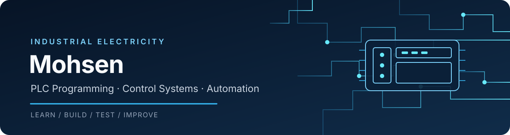

<!-- Profile README for Mohsen831-cyrpto -->

# Mohsen
### Industrial Electricity · PLC Programming · Industrial Automation

Building practical skills in electrical control systems, Siemens PLCs, and industrial automation.

---

## About

I'm a technical student specialising in **industrial electricity**. I use GitHub to document what I learn, organise practical exercises, and build a portfolio of electrical-control and PLC projects.

My approach is practical and transparent: I aim to document each project clearly, distinguish planned work from tested results, and improve through feedback.

## Technical toolkit

| Area | Tools and topics |
|---|---|
| **PLC platforms** | Siemens SIMATIC S7-300, S7-400, S7-1200 |
| **PLC engineering software** | TIA Portal, STEP 7 / SIMATIC Manager |
| **PLC languages** | LAD (Ladder Logic), FBD |
| **Industrial control** | Control circuits, contactors, timers, motor-control fundamentals |
| **HMI / monitoring** | WinCC and SCADA fundamentals |
| **Electrical design** | AutoCAD, AutoCAD Electrical |

  
  
  
  
  

*These are areas I study and practise; listing a tool does not imply expert-level proficiency.*

## Selected work

### [Electrical — Industrial Automation Portfolio](https://github.com/Mohsen831-cyrpto/Electrical)
A central place for my industrial-electricity notes, PLC exercises, and technical documentation.

### [LOGO! Pulse Relay Exercise](https://github.com/Mohsen831-cyrpto/Electrical/tree/main/projects/logo-pulse-relay)
A LOGO! Soft Comfort exercise covering pushbutton inputs, OR logic, a pulse relay, and output Q1. Includes a test plan; simulation results will be documented after verification.

## Current development

- Practising PLC logic in LAD and FBD
- Strengthening understanding of industrial control circuits and troubleshooting
- Improving technical documentation and project presentation
- Continuing German-language study for future technical opportunities

## Achievement

**National second place** in a programming / application-design category at the Khwarizmi Festival.

## Collaboration

I'm glad to learn from people working with PLCs, electrical control systems, and automation. Constructive feedback on my project documentation is welcome.

---

  Learning by building, documenting, testing, and improving.

